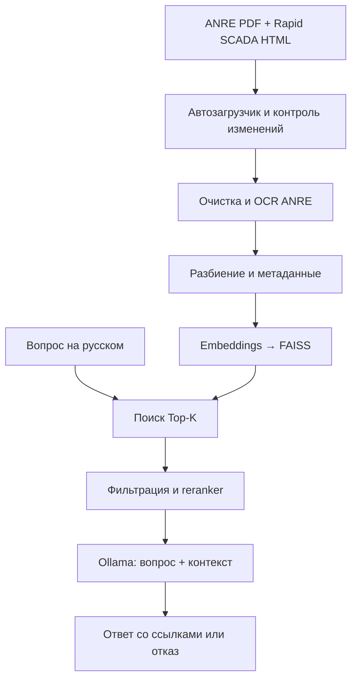

# Лабораторная №1: RAG по SCADA и рискам технических проверок

Локальная система отвечает на русском языке по документации Rapid SCADA и методологии ANRE №586 от 16.10.2024. Работает на Windows с Ryzen 5 и 16 ГБ ОЗУ, без обязательной видеокарты и платных API. Интерфейс: **http://localhost:8000**.

## Быстрый запуск на Windows

1. Установите **Python 3.11, 64-bit** с [python.org](https://www.python.org/downloads/windows/). Отметьте **Add Python to PATH**. Python 3.12 также поддерживается. Python 3.13/3.14 для этого зафиксированного окружения не использовать.
2. Скачайте репозиторий через **Code → Download ZIP**, распакуйте его в обычную папку, например `C:\Projects\PAD-LAB-1`. Не запускайте файлы из окна ZIP.
3. Откройте **setup.bat**. Скрипт создаст отдельное Python-окружение, установит CPU-зависимости, Ollama и Tesseract через winget при необходимости, скачает модель Qwen, автоматически получит документы и построит индекс. Установка Tesseract может вызвать стандартное окно Windows с запросом прав администратора.
4. После успешной установки откройте **start.bat**. Оставьте окно открытым. Браузер откроется автоматически; дождитесь статуса «Система готова».
5. Для остановки нажмите **Ctrl+C** в окне программы. Если предыдущий запуск завис, откройте **restart.bat**: он перезапускает только сервер этого проекта и выгружает его модель Qwen, не затрагивая другие Python-проекты.

Первоначальная установка требует интернета и нескольких гигабайт загрузок. Заранее освободите около 15 ГБ на диске. После загрузки всех моделей и документов чат работает локально. Повторное обновление документов и загрузка второй embedding-модели требуют интернета. Быстродействие зависит от модели Ryzen 5; первая генерация загружает модели и выполняется дольше последующих.

Если winget отсутствует, установите [Ollama](https://ollama.com/download/windows) и [Tesseract для Windows](https://github.com/UB-Mannheim/tesseract/wiki) вручную, затем повторите `setup.bat`. Система автоматически получает румынский языковой пакет OCR.

`setup.bat` можно запускать повторно. Файлы окружения, модели, журналы и индексы исключены из Git. API-ключи не нужны.

## Что можно делать в интерфейсе

- Задавать вопросы и открывать подтверждающие фрагменты с исходными ссылками.
- Ограничивать поиск конкретным документом.
- Менять Top-K и порог сходства, включать и отключать reranker.
- Переключать два варианта инструкции модели.
- Обновлять корпус автоматическим загрузчиком.
- Просматривать таблицы фактических результатов экспериментов.

Примеры вопросов:

- Как устроена архитектура Rapid SCADA?
- Зачем для Вебстанции рекомендуют HTTPS и VPN?
- Чем отличаются Сервер и Коммуникатор?
- Для чего применяется методология ANRE №586?
- Какой IP-адрес SCADA-сервера Дубоссарской ГЭС? — ожидается отказ: такого документа в корпусе нет.

## Корпус и происхождение данных

**ANRE, постановление №586 от 16.10.2024.** Ссылка с `page=137` ведёт на изменяющуюся страницу реестра. Загрузчик ищет документ по номеру и году, проверяет заголовок и находит актуальную ссылку на PDF. [Реестр с фильтром](https://anre.md/registru-hotraririlor-3-371?decision_number=586&year=2024), [официальный PDF](https://anre.md/storage/upload/administration/hcareports/3675/HCA%20nr.%20586%20din16.10.2024.pdf).

Исходный PDF содержит **32 отсканированные страницы на румынском языке**. Используются Tesseract `ron` и PDFium. Индексируется распознанный оригинал: автоматический перевод базы отключён после проверки, выявившей искажения нормативных формулировок. Многоязычная embedding-модель сопоставляет вопросы на русском с текстом оригинала. Интерфейс и ответы остаются на русском языке; карточка источника показывает исходный фрагмент на его языке.

Результат OCR сохраняется в `data/snapshots/anre-586.json`, если снимок включён в проверенную версию проекта. Загрузчик всё равно скачивает PDF и использует кэш только при совпадении SHA-256. Если оригинал изменился, OCR выполняется заново. Числа и нормативные формулировки следует сверять с PDF: распознавание таблиц может ошибаться.

Методология ANRE посвящена **рискам технических проверок электроустановок, электростанций и сетей**. Она не заменяет методику оценки киберрисков SCADA. Это различие закреплено в инструкции модели.

**Rapid SCADA 6.4.** Автоматически загружаются 15 русскоязычных страниц [официальной документации](https://rapidscada.net/docs/ru/6.4/): архитектура, приложения, безопасность, конфигурация, роли, каналы, скрипты, опрос устройств, экспорт, Modbus, аудит и защита от перебора. Этот источник покрывает техническую сторону SCADA. Возможности конкретного продукта не объявляются универсальными свойствами любой SCADA.

Полный список источников: [configs/sources.json](configs/sources.json). Метаданные включают URL, название, раздел, страницу, язык, время обновления и SHA-256.

## Архитектура и выбранные компоненты

| Этап | Реализация и обоснование |
| --- | --- |
| Автосбор | urllib, HTTP ETag/Last-Modified, SHA-256, повторные попытки, журнал ошибок, повторный запуск без ручной подготовки |
| Обработка | BeautifulSoup для HTML; pypdf и PDFium/Tesseract для PDF; удаление меню, нормализация Unicode и пробелов |
| Разбиение | Фиксированные окна, окна с overlap, абзацы, секции; размеры задаются **в символах**, не в токенах |
| Embeddings | `intfloat/multilingual-e5-small`, 384 измерения, русский и румынский языки; префиксы `query:` и `passage:`, нормализация L2 |
| Альтернатива embeddings | `sentence-transformers/paraphrase-multilingual-MiniLM-L12-v2`, 384 измерения; сравнивается с E5 при одинаковых остальных параметрах |
| Векторное хранилище | FAISS CPU `IndexFlatIP` и JSON метаданных: точный косинусный поиск без отдельного сервера, достаточно для небольшого корпуса |
| Reranker | Многоязычный `cross-encoder/mmarco-mMiniLMv2-L12-H384-v1`; оценивает пары «вопрос–фрагмент» на CPU |
| Фильтры | Порог косинусного сходства, минимальная длина, точные дубликаты, metadata source_id, порог reranker, лимит фрагментов и размера контекста |
| Генерация | Локальный Ollama, `qwen2.5:3b` в Q4; компактная модель с поддержкой русского языка |
| Ответ | JSON-схема с флагом answerable и номерами источников; проверка ссылок на присутствие в переданном контексте |
| Интерфейс | HTML/CSS/JavaScript без внешних CDN; Python HTTP-сервер слушает только 127.0.0.1 |



Индекс зависит от содержимого корпуса, embedding-модели и параметров разбиения. Несовместимые индексы не смешиваются. Число фрагментов, которые могут быть усечены по лимиту 512 токенов, записывается в метаданные индекса (`truncated_chunks`). При изменении модели пересоздаётся индекс. FAISS сериализуется через байты для поддержки путей Windows с кириллицей.

Пороги сходства и reranker — **экспериментальные параметры**, а не вероятности правильного ответа. Наличие корректной ссылки само по себе не доказывает достоверность текста ответа. Маленькая LLM может ошибаться даже при RAG: это отдельно проверяется оценкой ответов.

## Эксперименты и оценка

Откройте **experiments.bat**. Перед длительным исследованием закройте окно `start.bat`, чтобы не загружать несколько копий моделей.

1. **Поиск на dev-наборе:** размеры 600/1000/1400 символов, overlap 0/150/300, 4 стратегии разбиения, две embedding-модели, K=3/5/10/20, reranker включён/выключен, разные пороги.
2. **Полная оценка с генерацией:** каждый вопрос из `data/questions.json`, включая вопросы без ответа.
3. **Генерация на dev-наборе:** два prompts и два режима температуры одной модели. Сначала baseline, затем меняется ровно один параметр.
4. **Отложенная проверка поиска:** test-набор после выбора конфигурации по dev.

Разметка содержит ожидаемые ответы и короткие якоря подтверждающего текста. Для нескольких документов задаются отдельные группы доказательств. Релевантность проверяется по документу **и текстовому фрагменту**, а не только по совпадению URL. Перед оценкой проверяется, что все эталонные якоря есть в корпусе; при изменении источников оценка останавливается вместо выдачи недостоверных метрик.

Метрики поиска: Recall@K, Precision@K, MRR, Hit Rate, доля вопросов со всеми найденными доказательствами. Отдельно считаются показатели сырого Top-K и финального контекста. Recall — доля покрытых размеченных групп доказательств; Precision — доля релевантных фрагментов среди K позиций (неполная выдача штрафуется). Невозможные вопросы исключены из положительных retrieval-метрик и используются для оценки отказов.

Метрики ответа: правильность решения ответить/отказаться, доля ложных ответов на невозможные вопросы, покрытие эталонных ключевых фраз и принадлежность ссылок контексту. Покрытие фраз — лексический индикатор, а не семантическая оценка. Для оценки обоснованности и полезности генерируется `manual_review.csv`: выставите 0 — не подтверждается/не отвечает, 1 — частично, 2 — полностью. Поля ручной оценки не заполняются вымышленными баллами.

Фактические результаты сохраняются в `experiments/runs/`: конфигурации, идентификатор корпуса, системное окружение, сырые выдачи, ответы, CSV и JSON. Зафиксированные проверенные запуски находятся в `experiments/verified/`. Модели и исходные документы в Git не помещаются; загружаются автоматически.

## Запуск через команды

После `setup.bat` из корня проекта:

```powershell
.venv\Scripts\python.exe -m scada_rag doctor
.venv\Scripts\python.exe -m scada_rag grab
.venv\Scripts\python.exe -m scada_rag index
.venv\Scripts\python.exe -m scada_rag serve --open
.venv\Scripts\python.exe -m scada_rag ask "Зачем использовать HTTPS?"
.venv\Scripts\python.exe -m scada_rag experiments --suite retrieval --split dev
.venv\Scripts\python.exe -m scada_rag evaluate --generate --split all
.venv\Scripts\python.exe -m scada_rag experiments --suite generation --split dev
.venv\Scripts\python.exe -m scada_rag evaluate --split test
.venv\Scripts\python.exe -m unittest discover -s tests -v
```

Для сокращённого сравнения генерации используйте `experiments --suite generation --split dev --limit 12`. Выборка фиксируется seed=42, её состав сохраняется в результатах. Это отдельный эксперимент; полная базовая оценка запускается на всех вопросах.

Для Linux: создайте venv, установите CPU PyTorch, `requirements.txt`, `pip install -e .`, Ollama и Tesseract. Все основные команды одинаковы. Путь проекта можно переопределить переменной `SCADA_RAG_ROOT`.

## Если возникла ошибка

| Сообщение | Действие |
| --- | --- |
| Python не найден | Установите Python 3.11 x64 с Add Python to PATH, повторите setup |
| Ollama недоступен | Откройте приложение Ollama; выполните `ollama pull qwen2.5:3b` |
| База не подготовлена | Нажмите «Подготовить документы» или выполните `python -m scada_rag prepare` |
| Ошибка OCR | Проверьте наличие Tesseract, доступ к GitHub для `ron.traineddata` |
| Скачивание модели прервалось | Повторите setup; исправные кэши сохраняются |
| Порт 8000 занят | Закройте предыдущий запуск или используйте `serve --port 8001 --open` |
| Пустые ответы | Проверьте источники; временно уменьшите порог сходства и сравните результаты с reranker и без него |
| Изменились эталонные фрагменты | Сверьте изменившийся документ и обновите разметку в questions.json; не удаляйте проверку |

## Структура

```text
configs/                 Источники и параметры
src/scada_rag/grabber/   Автосбор и OCR
src/scada_rag/preprocessing/
src/scada_rag/embeddings/
src/scada_rag/retrieval/
src/scada_rag/reranking/
src/scada_rag/generation/
src/scada_rag/evaluation/
src/scada_rag/web/       Локальный интерфейс
data/questions.json     Размеченные вопросы
experiments/verified/   Фактические проверенные результаты
tests/                  Автономные тесты
setup.bat / setup.ps1   Первоначальная установка Windows
start.bat               Запуск localhost
experiments.bat         Запуск исследований
```

Нейросетевые модели используются по их собственным лицензиям: E5 — MIT, multilingual MiniLM и reranker — Apache 2.0, Qwen 3B — Qwen Research License. Проект предназначен для учебного исследования. Сведения о моделях: [E5](https://huggingface.co/intfloat/multilingual-e5-small), [MiniLM](https://huggingface.co/sentence-transformers/paraphrase-multilingual-MiniLM-L12-v2), [reranker](https://huggingface.co/cross-encoder/mmarco-mMiniLMv2-L12-H384-v1), [Qwen](https://ollama.com/library/qwen2.5:3b).
